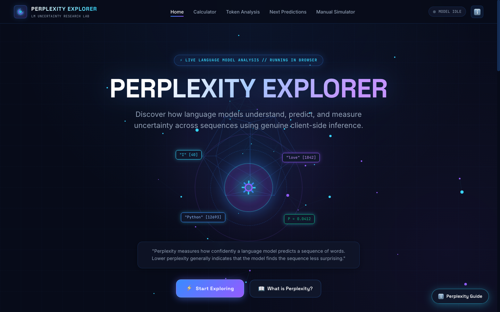
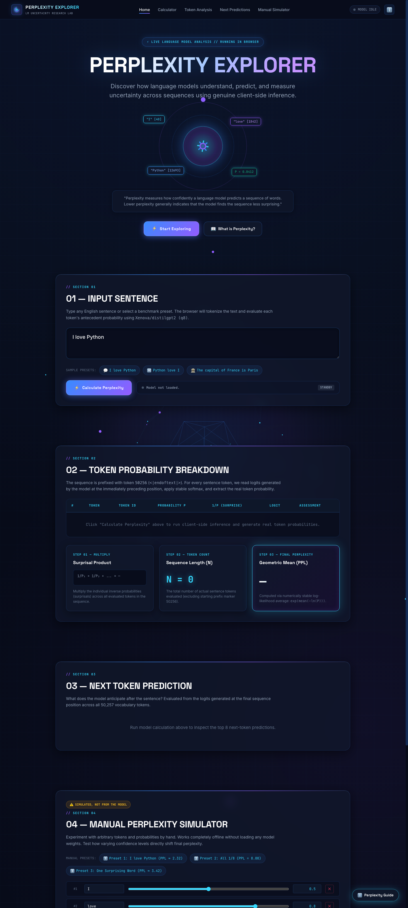
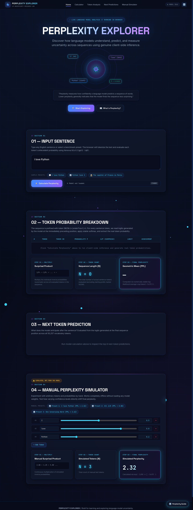
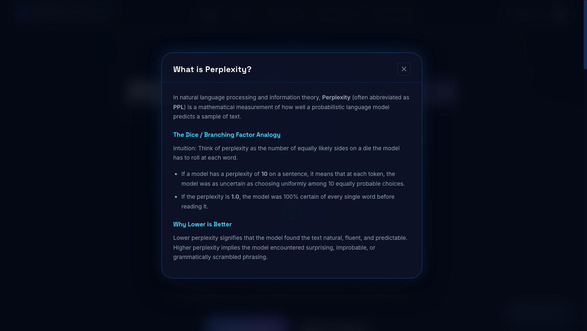

# ⚡ PERPLEXITY EXPLORER

> Discover how language models understand, predict, and measure uncertainty across sequences using genuine client-side inference.



**Perplexity Explorer** is a high-end futuristic AI research dashboard that calculates and visualizes language-model perplexity using a real browser-based language model (`Xenova/distilgpt2`, quantized `q8`) via [Hugging Face Transformers.js v3](https://huggingface.co/docs/transformers.js).

---

## 🚀 Key Features

- **Genuine Client-Side Language Model**:
  - Powered by `Xenova/distilgpt2` (`q8`) running 100% locally in your browser via WebAssembly / ONNX Runtime.
  - Zero API keys, zero backend servers, zero telemetry data transmitted.
  - Tokenization prefixed by start context token `50256` (`<|endoftext|>`).
  - Antecedent logit alignment: for every token $w_i$, probabilities $P(w_i \mid w_{<i})$ are computed from preceding position $i - 1$ logits.
  - Numerically stable softmax with $\max(\text{logit})$ subtraction.

- **Token Probability Breakdown**:
  - High-tech interactive data table displaying decoded subwords, whitespace markers (`␣`), probabilities, inverse surprisals ($1/P$), and logits.
  - **Step 1:** Surprisal product accumulation ($1/P_1 \times 1/P_2 \times \dots$).
  - **Step 2:** Token count ($N$) normalization.
  - **Step 3:** Final perplexity via $\exp(\text{mean}(-\ln P))$.

- **Next-Token Prediction**:
  - Live top-8 continuation predictions derived from logits at final sequence position.
  - Glowing horizontal probability distribution bars with percentage values and ranking badges.

- **Manual Perplexity Simulator (Offline Sandbox)**:
  - Add, remove, and modify arbitrary token names and probability sliders with instantaneous reactive updates.
  - Three verified mathematical benchmark presets:
    - **Preset 1 (I love Python):** $P = [0.5, 0.8, 0.2] \implies \text{PPL} \approx 2.32$
    - **Preset 2 (All 1/8):** $P_i = 0.125 \text{ for } 8 \text{ tokens} \implies \text{PPL} = 8.00$ exactly
    - **Preset 3 (One surprising word):** $P = [0.9, 0.9, 0.9, 0.01] \implies \text{PPL} \approx 3.42$

- **Futuristic 3D Interface**:
  - 3D interactive particle constellation canvas with rotating wireframe icosahedron and volumetric atmospheric lighting.
  - Dynamic 3D glass card tilt tracking cursor coordinates.
  - Three interactive 3D educational modal windows explaining intuition, causal pipeline, and score interpretations.
  - Fully responsive across desktop, tablet, and mobile devices.

---

## 📐 Mathematical Formulation

$$\text{Perplexity}(W) = \left( \prod_{i=1}^N \frac{1}{P(w_i \mid w_{<i})} \right)^{1/N} = \exp\left( \frac{1}{N} \sum_{i=1}^N -\ln P(w_i \mid w_{<i}) \right)$$

Where:
- $W = (w_1, w_2, \dots, w_N)$ represents the sequence of tokens.
- $P(w_i \mid w_{<i})$ is the probability assigned to token $w_i$ by the model given all antecedent context tokens.
- To prevent numerical underflow/overflow, the geometric mean is computed using the average negative log-likelihood.

---

## 📸 Screenshots

| Hero & Holographic Core | Token Analysis & Calculations |
|---|---|
|  |  |

| Manual Simulator & Steps | Educational 3D Modal |
|---|---|
|  |  |

---

## 💻 How to Run Locally

No build tools, compilation, or npm installs required. Simply open `index.html`:

```bash
# Direct browser launch
open index.html

# Or run with any local HTTP server
python3 -m http.server 8080
# Open http://localhost:8080
```

---

## 📜 License

MIT License. Built for learning and exploring language model uncertainty.
